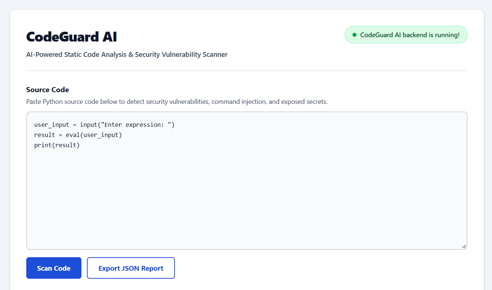
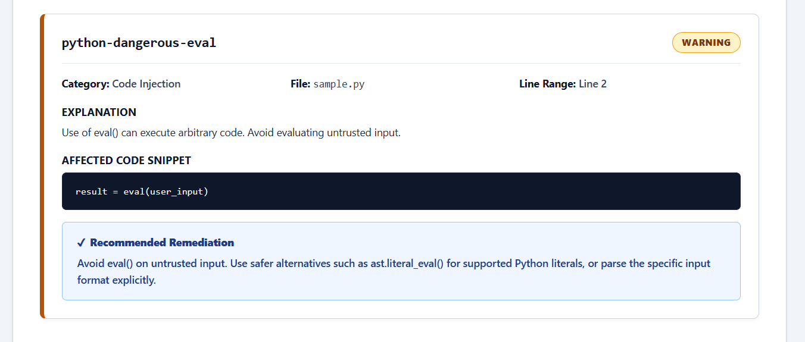
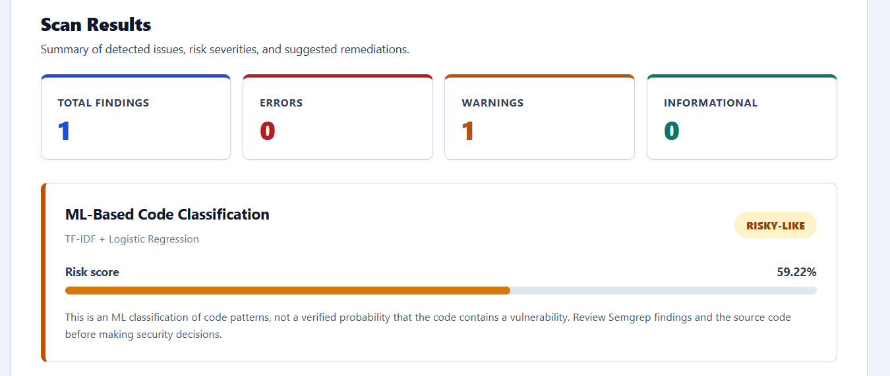
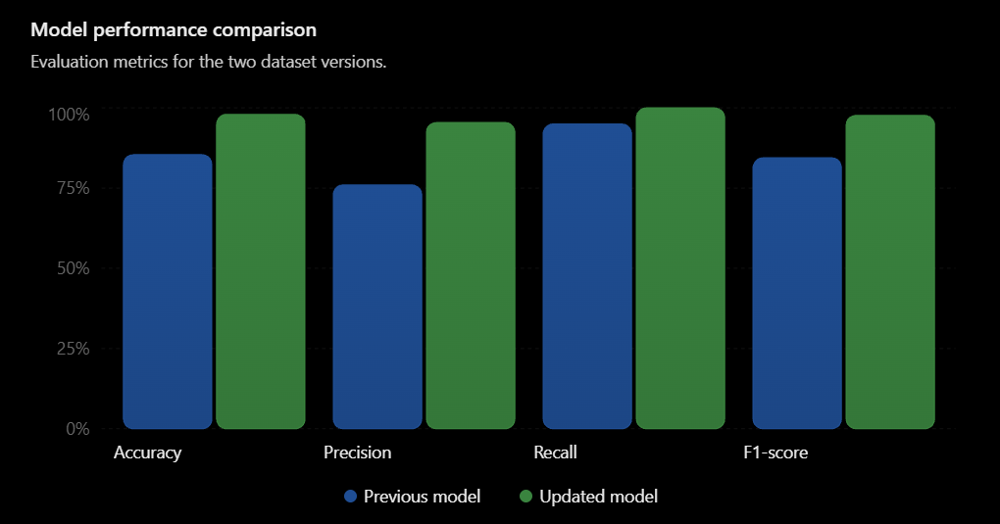
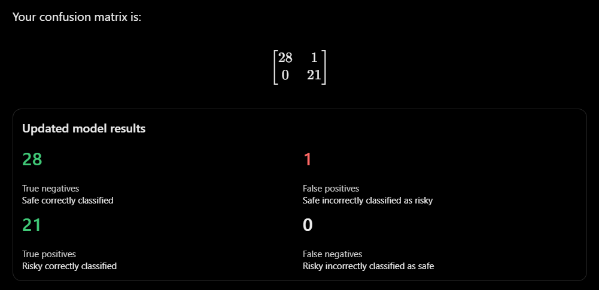
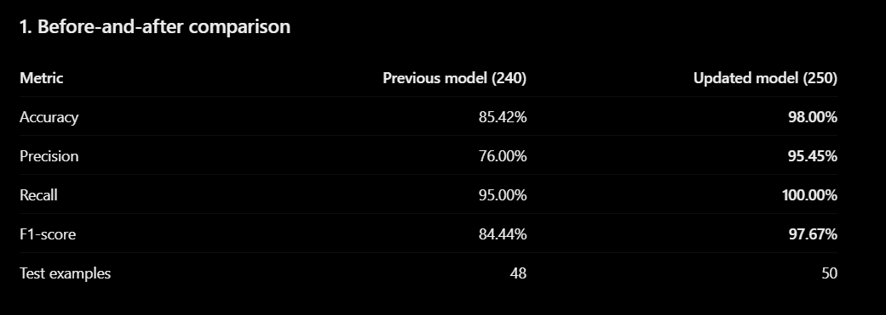
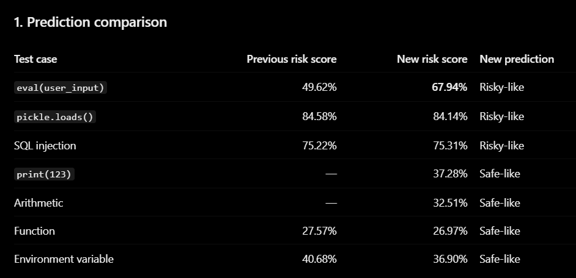
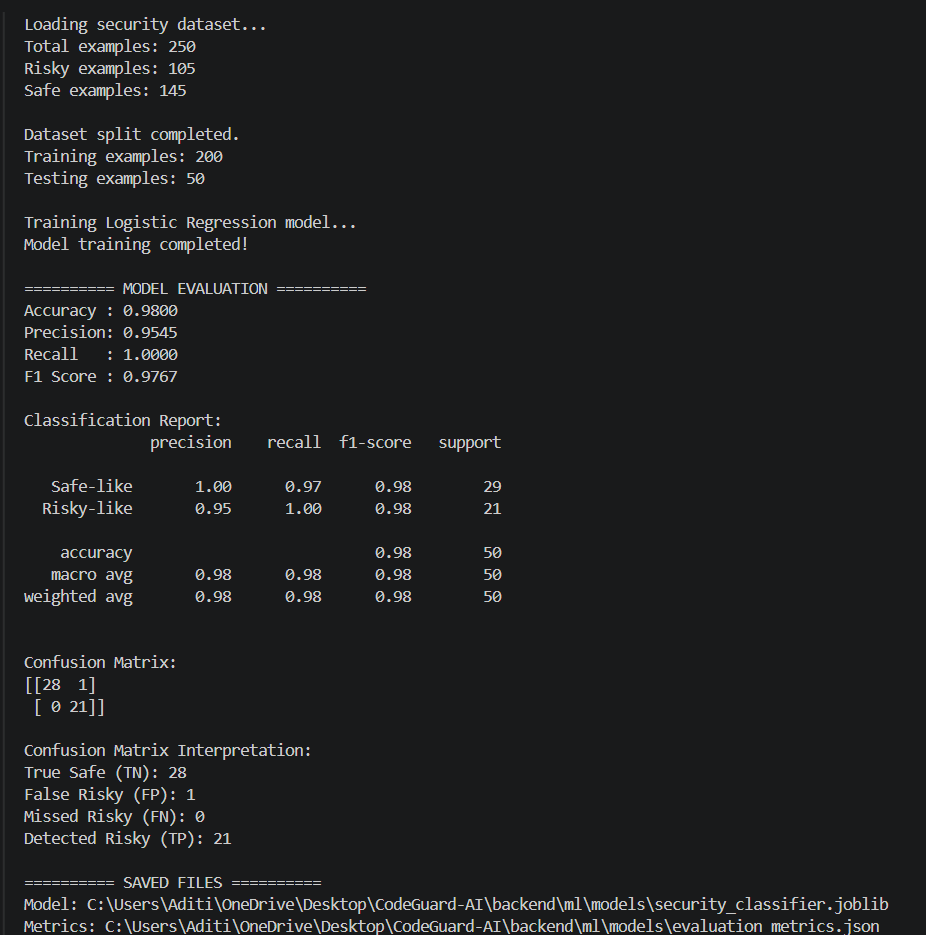
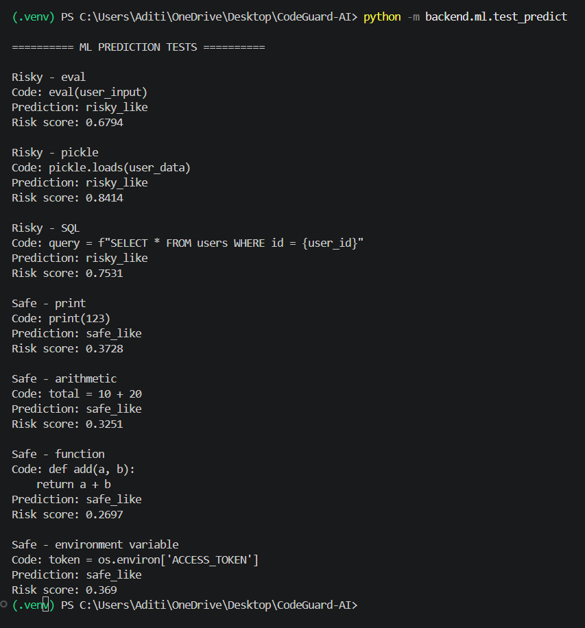

# CodeGuard AI

**Find bugs. Understand risks. Write safer code.**

CodeGuard AI is an AI-assisted Python code security analyzer that combines **Semgrep rule-based static analysis** with a **machine learning code classifier**. It scans submitted Python source code for selected security weaknesses, explains detected findings, suggests remediation steps, and displays an ML-based `risky_like` or `safe_like` classification.

The project is a working prototype intended to demonstrate how traditional static analysis and supervised machine learning can complement each other in a developer-focused security workflow.



---

## Table of Contents

- [Features](#features)
- [Screenshots](#screenshots)
- [How It Works](#how-it-works)
- [Supported Security Checks](#supported-security-checks)
- [Machine Learning Model](#machine-learning-model)
- [Technology Stack](#technology-stack)
- [Project Structure](#project-structure)
- [Getting Started](#getting-started)
- [API Reference](#api-reference)
- [Limitations](#limitations)
- [Future Scope](#future-scope)
- [License](#license)

---

## Features

- **Rule-based static analysis:** Uses Semgrep and custom Python security rules to identify selected vulnerability patterns.
- **ML-based code classification:** Uses character-level TF-IDF features and Logistic Regression to classify code as `risky_like` or `safe_like`.
- **Combined scan response:** The `/scan` endpoint returns Semgrep findings alongside the ML prediction.
- **Actionable findings:** Displays severity, category, explanation, affected code, file/line information, and remediation guidance when a rule matches.
- **Interactive dashboard:** React interface for submitting Python code and viewing scan results.
- **Severity summary:** Displays total findings and counts for errors, warnings, and informational findings.
- **Risk score visualization:** Shows the ML model's score alongside its predicted class.
- **JSON report export:** Downloads a structured Semgrep security report through `/scan/report`.
- **Health endpoint:** Provides a backend health check through `/health`.

> **Important:** The ML risk score is a model output for the `risky_like` class. It is not a calibrated probability that the submitted code contains a vulnerability. A `safe_like` prediction does not override a Semgrep finding.

---

## Screenshots

### Dashboard


### Semgrep detection and remediation



### ML-based classification in the dashboard



### Model evaluation

The model was evaluated using a stratified random 80:20 split of the 250-example dataset. The test split contained 50 examples.





### Dataset expansion and prediction tests









---

## How It Works

The application uses two complementary analysis paths:

1. A user submits Python source code through the React frontend.
2. FastAPI receives the code through `POST /scan`.
3. Semgrep scans the submitted source using the configured custom rules.
4. The ML pipeline transforms the source into character-level TF-IDF features.
5. Logistic Regression predicts `risky_like` or `safe_like` and returns a risk score.
6. FastAPI returns both the Semgrep findings and the ML result.
7. The React dashboard displays the results.

```text
                  Python Source Code
                          |
                          v
                 React + Vite Frontend
                          |
                       HTTP/JSON
                          |
                          v
                    FastAPI Backend
                          |
              +-----------+-----------+
              |                       |
              v                       v
        Semgrep Scanner          ML Classifier
        Custom YAML Rules        TF-IDF + Logistic
              |                       |
              v                       v
       Security Findings        Class + Risk Score
              |                       |
              +-----------+-----------+
                          |
                          v
                 Combined /scan Response
                          |
                          v
                  Results Dashboard
```

The two outputs should be interpreted together. Semgrep findings remain visible even if the ML classifier predicts `safe_like`.

---

## Supported Security Checks

The custom Semgrep rules in the project cover the following categories:

| Rule ID | Category | Severity | Description |
|---|---|---|---|
| `python-dangerous-eval` | Code Injection | `WARNING` | Detects potentially unsafe use of `eval()`. |
| `python-hardcoded-secret` | Hardcoded Secrets | `WARNING` | Detects hardcoded credentials, keys, or tokens matching the rule patterns. |
| `python-sql-injection-fstring` | SQL Injection | `WARNING` | Detects selected unsafe SQL query construction patterns. |
| `python-unsafe-pickle` | Unsafe Deserialization | `ERROR` | Flags selected uses of `pickle` deserialization. |
| `python-command-injection` | Command Injection | `ERROR` | Detects selected unsafe shell/command execution patterns. |
| `python-unsafe-tempfile` | Insecure File Handling | `WARNING` | Detects insecure temporary-file creation using `mktemp()` patterns. |

Detection depends on the configured Semgrep rules. This list does not imply that every possible vulnerability in each category will be detected.

---

## Machine Learning Model

### Dataset

The current training dataset contains **250 labelled Python code examples**:

| Class | Label | Examples |
|---|---:|---:|
| Risky-like | 1 | 105 |
| Safe-like | 0 | 145 |
| **Total** | | **250** |

Examples cover dynamic code execution, hardcoded credentials, SQL injection, unsafe deserialization, command execution, safer alternatives, and general Python code.

### Model pipeline

- **Feature extraction:** `TfidfVectorizer`
- **Analyzer:** Character-level
- **N-gram range:** 2–5
- **Maximum features:** 5,000
- **Classifier:** Logistic Regression
- **Maximum iterations:** 1,000
- **Class weighting:** Balanced
- **Train/test split:** 80:20, stratified, with `random_state=42`
- **Model persistence:** Joblib

### Current evaluation results

| Metric | Result |
|---|---:|
| Accuracy | 98.00% |
| Precision | 95.45% |
| Recall | 100.00% |
| F1-score | 97.67% |
| Training examples | 200 |
| Testing examples | 50 |

Confusion matrix (rows = actual class; columns = predicted class; class order = safe-like, risky-like):

```text
                 Predicted
                 Safe  Risky
Actual Safe       28     1
Actual Risky       0    21
```

These are preliminary results from a small, manually constructed dataset and a random split. Similar examples may occur in both training and testing subsets. The metrics should not be interpreted as production-level performance or as proof of generalization to unseen repositories. Independent evaluation on a larger, separately collected dataset is still needed.

### Manual prediction checks

The seven selected manual test cases produced the expected class in the recorded tests:

- **Risky-like:** `eval(user_input)`, `pickle.loads(user_data)`, SQL injection example.
- **Safe-like:** `print(123)`, arithmetic, a simple function, environment-variable access.

These are functional sanity checks, not a separate benchmark or an additional accuracy estimate.

---

## Technology Stack

| Layer | Technologies |
|---|---|
| Frontend | React, Vite, JavaScript, CSS |
| Backend | Python, FastAPI, Uvicorn |
| Static analysis | Semgrep |
| ML and data processing | Scikit-learn, pandas, NumPy |
| Text representation | TF-IDF character n-grams |
| Classification | Logistic Regression |
| Model persistence | Joblib |
| Report format | JSON |

---

## Project Structure

```text
codeguard-ai/
├── backend/
│   ├── main.py
│   ├── scanner.py
│   ├── requirements.txt
│   └── ml/
│       ├── __init__.py
│       ├── predict.py
│       ├── train_model.py
│       ├── test_predict.py
│       ├── dataset/
│       │   ├── create_dataset.py
│       │   └── security_dataset.csv
│       └── models/
│           ├── security_classifier.joblib
│           └── evaluation_metrics.json
├── frontend/
│   ├── src/
│   │   ├── App.jsx
│   │   ├── main.jsx
│   │   ├── index.css
│   │   └── App.css
│   ├── index.html
│   └── package.json
├── semgrep-rules/
│   └── python-security.yml
├── assets/
│   ├── ui-dashboard.png
│   ├── semgrep-scan-result.png
│   ├── ml-classification-result.png
│   ├── model-performance-comparison.png
│   ├── confusion-matrix.png
│   ├── dataset-before-after.png
│   ├── prediction-comparison.png
│   ├── training-evaluation-terminal.png
│   └── prediction-tests-terminal.png
├── .gitignore
└── README.md
```

---

## Getting Started

### Prerequisites

- Python 3.10 or newer
- Node.js and npm
- Git
- Semgrep CLI installed separately and available to the backend scanner

> On Windows, Semgrep may need to be installed separately from the Python dependencies. Follow the Semgrep installation method configured for your environment. The project's `requirements.txt` does not install the Semgrep CLI.

### 1. Clone the repository

```bash
git clone https://github.com/Aditi-Gupta21/codeguard-ai.git
cd codeguard-ai
```

### 2. Set up the backend

```bash
cd backend

python -m venv .venv
```

Activate the environment.

**Windows PowerShell:**

```powershell
.\.venv\Scripts\Activate.ps1
```

**macOS/Linux:**

```bash
source .venv/bin/activate
```

Install Python dependencies:

```bash
pip install -r requirements.txt
```

Start the API from the `backend` directory:

```bash
python -m uvicorn main:app --reload --host 127.0.0.1 --port 8001
```

Backend base URL:

```text
http://127.0.0.1:8001
```

Interactive API documentation:

```text
http://127.0.0.1:8001/docs
```

### 3. Set up the frontend

Open a second terminal from the repository root:

```bash
cd frontend
npm install
npm run dev
```

Open the Vite URL shown in the terminal, normally:

```text
http://localhost:5173
```

Ensure the frontend API base URL points to the backend running on port `8001`.

### 4. Retrain the ML model (optional)

From the repository root, with the backend virtual environment activated:

```bash
python backend/ml/dataset/create_dataset.py
python -m backend.ml.train_model
```

The trained model and evaluation metrics are saved under `backend/ml/models/`.

Run the manual prediction checks:

```bash
python -m backend.ml.test_predict
```

---

## API Reference

The examples below assume the backend is running at `http://127.0.0.1:8001`.

### `GET /`

Checks backend connectivity.

```bash
curl http://127.0.0.1:8001/
```

### `GET /health`

Checks backend health.

```bash
curl http://127.0.0.1:8001/health
```

### `POST /scan`

Scans submitted Python code and returns Semgrep findings together with the ML classification.

```bash
curl -X POST http://127.0.0.1:8001/scan \
  -H "Content-Type: application/json" \
  -d "{\"code\":\"user_input = input()\\nresult = eval(user_input)\"}"
```

Example response shape:

```json
{
  "findings": [
    {
      "rule_id": "python-dangerous-eval",
      "severity": "WARNING",
      "category": "Code Injection",
      "message": "Use of eval() can execute arbitrary code. Avoid evaluating untrusted input.",
      "remediation": "Avoid eval() on untrusted input. Use safer alternatives such as ast.literal_eval() for supported Python literals, or parse the specific input format explicitly.",
      "file_path": "sample.py",
      "start_line": 2,
      "end_line": 2,
      "code_snippet": "result = eval(user_input)"
    }
  ],
  "total_findings": 1,
  "ml_prediction": {
    "prediction": "risky_like",
    "risk_score": 0.5826,
    "model": "TF-IDF + Logistic Regression"
  }
}
```

The risk score above is an illustrative observed response. Actual values depend on the submitted source code and the loaded model.

### `POST /scan/report`

Scans submitted code and returns a downloadable JSON report containing the Semgrep findings and summary. In the current implementation, this report endpoint is Semgrep-based; it does not include the ML prediction.

```bash
curl -X POST http://127.0.0.1:8001/scan/report \
  -H "Content-Type: application/json" \
  -d "{\"code\":\"eval(input())\"}" \
  -o codeguard-report.json
```

The response is delivered with a downloadable filename:

```text
codeguard-report.json
```

---

## Limitations

- The current ML dataset is small and manually prepared.
- The classifier predicts patterns similar to those represented in its training data; it does not understand program behavior like a full security auditor.
- The reported test metrics come from a random split and may be optimistic if related examples appear in both subsets.
- The risk score is not a calibrated vulnerability probability.
- Semgrep detection is limited to the configured rules and supported patterns.
- The current implementation focuses on Python source code.
- A clean scan does not guarantee that code is secure.

---

## Future Scope

- Expand the dataset with diverse, independently labelled code examples.
- Evaluate using repository-level and independently collected test data.
- Add support for more programming languages.
- Explore transformer-based code models.
- Integrate an LLM to produce context-aware explanations and remediation suggestions.
- Add Retrieval-Augmented Generation (RAG) using trusted security documentation.
- Support complete Git repository scanning and CI/CD integration.

---

## License

This project is licensed under the MIT License. See the [`LICENSE`](LICENSE) file for details, if included in the repository.

---

**CodeGuard AI — Find bugs. Understand risks. Write safer code.**
